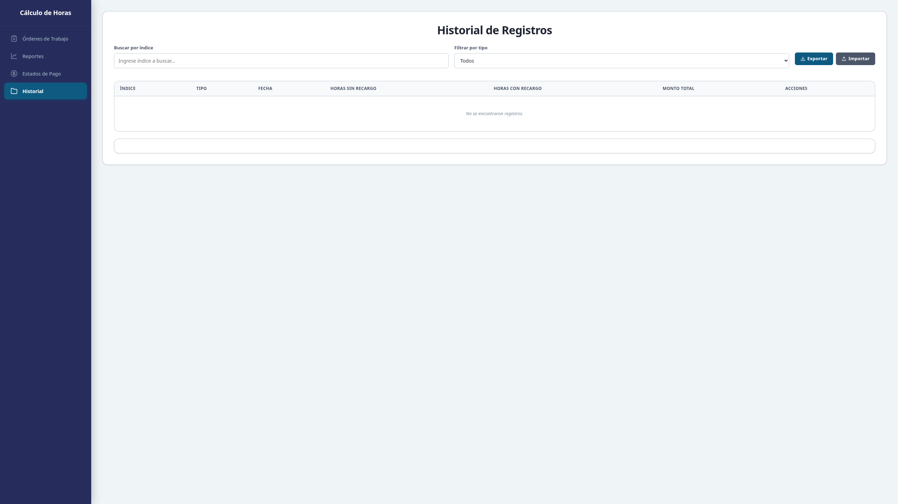

# ⏱️ Cálculo de Horas

Herramienta web para calcular los costos del servicio de una organización, basada en las horas trabajadas por el personal, considerando distintos tipos de jornada y reglas de recargo.

## 🧠 Problema que Resuelve

En muchas organizaciones, el cálculo de costos de servicios requiere considerar:

- **Días normales, sábados, domingos y festivos**, cada uno con reglas distintas de recargo.
- **Horas sin recargo y con recargo** (con porcentaje de recargo configurable desde la página Configuración: por defecto 0%, 10%, 20% y 30%).
- **Horas dobles del operador**, que aplican en horarios específicos (antes de las 07:00, después de las 19:00, o todo el día según el tipo de jornada).
- **Descuentos por colación**, que pueden aplicarse a horas con o sin recargo según se requiera.
- **Jornadas que cruzan la medianoche**, donde el cálculo debe considerar correctamente el paso de un día a otro.
- **Mínimo de horas garantizado**, que asegura un piso mínimo de horas facturables.
- **Servicios de uno o varios días** que consolidan las jornadas en un solo cálculo con totales generales.
- **Almacenamiento persistente** de cálculos para consulta y reutilización posterior.

Esta herramienta automatiza todos estos cálculos, evitando errores manuales y entregando resultados precisos al instante.

## 🚀 Funcionalidades

### 🧾 Cálculo de Servicios
- Cálculo de un servicio de **uno o varios días** en una sola página.
- Ingreso de jornada para cada día; los días sin hora de inicio y término no se incluyen en el cálculo.
- Cada día se categoriza automáticamente según su fecha (Normal, Sábado, Domingo/Festivo).
- Ingreso de hora de inicio y término (con soporte para jornadas que cruzan medianoche).
- **Repetición de horario**: una vez ingresados los tres datos de un día (hora de inicio, hora de término y colación), un modal pregunta si se desea repetir el mismo horario en el día siguiente; la consulta se repite día a día hasta responder que no.
- Valor hora seleccionable entre valores configurables desde Configuración o personalizado.
- Porcentaje de recargo configurable (por defecto 0%, 10%, 20% y 30%; ampliable desde Configuración).
- Mínimo de horas garantizado (por defecto 0, 5, 6, 8 o 9 horas; ampliable desde Configuración).
- Descuento opcional de tiempo de colación (15, 30, 45 o 60 minutos), aplicable a horas sin recargo o con recargo.
- Cálculo detallado por día y totales consolidados:
  - Horas sin recargo del servicio.
  - Horas con recargo del servicio (valor hora × multiplicador de recargo).
  - Horas normales del operador.
  - Horas dobles del operador.
  - Monto total del servicio.
- **Almacenamiento**: Guardar el servicio con un índice personalizado.

### 💰 Estados de Pago
- Agregación de servicios existentes buscándolos por índice.
- Cada registro agregado suma sus horas sin recargo, con recargo y monto total.
- **Costos adicionales**: Agregar ítems extra (tipo de costo configurable: traslado de contrapesos, traslado de equipo, plan de izaje, otros) con cantidad y valor unitario.
- Cálculo en vivo del total general con IVA (19%).
- **Logo de empresa**: Carga de logo vía URL con previsualización y almacenamiento persistente en localStorage.
- **Impresión PDF**: Genera una liquidación formal de servicios con encabezado (logo + datos empresa), detalle por jornada, resumen de montos, IVA y condiciones de pago.
- **Almacenamiento**: Guardar estados de pago con índice personalizado.

### 📁 Historial de Registros
- Tabla con todos los servicios almacenados.
- **Filtros**: búsqueda por índice y filtro por tipo (Servicios).
- **Acciones por registro**:
  - 👁️ **Ver**: Muestra detalle completo del servicio (días, horarios, horas y montos).
  - ✏️ **Modificar**: Redirige a Cálculo de Servicios con los datos cargados para editar.
  - 🗑️ **Eliminar**: Elimina el registro tras confirmación.
- **Exportar JSON**: Descarga todos los registros en formato JSON para usar en otros sistemas.
- **Importar JSON**: Carga registros desde un archivo JSON, fusionando con los existentes (actualiza si el índice ya existe, agrega si es nuevo) y migrando automáticamente los formatos antiguos.

### 🧾 Historial de Pagos
- Tabla con los estados de pago guardados.
- Acciones para ver el detalle, editar el estado de pago o eliminarlo.
- Al eliminar un estado de pago se eliminan también sus registros asociados, conservando los compartidos con otros estados de pago.

### ⚙️ Configuración
- **Logo de empresa**: Carga de logo vía URL con previsualización y almacenamiento persistente en localStorage.
- **Correlativo de estados de pago**: Número desde el cual inicia el correlativo automático.
- **Porcentajes de recargo**: incorporación y eliminación manual de los ítems que aparecen en el desplegable `% Recargo` de Cálculo de Servicios. El valor `Sin recargo` siempre está disponible y no puede eliminarse.
- **Mínimos de horas**: incorporación y eliminación manual de los ítems que aparecen en el desplegable `Mínimo de Horas` de Cálculo de Servicios. El valor `Sin mínimo` siempre está disponible y no puede eliminarse.
- **Valores de hora normal**: incorporación y eliminación manual de los ítems que aparecen en el desplegable `Valor Hora Normal` de Cálculo de Servicios. La opción `Otro valor...` siempre está disponible para ingresar un valor distinto.
- **Tipos de costo**: incorporación y eliminación manual de los ítems que aparecen en el desplegable `Tipo de costo` de Estados de Pago. Por defecto incluye `Traslado de contrapesos`, `Traslado de equipo`, `Plan izaje` y `Otros`.

## 🛠️ Tecnologías Utilizadas

| Tecnología                    | Descripción                                                                                     |
| ----------------------------- | ----------------------------------------------------------------------------------------------- |
| **HTML5**                     | Estructura de la aplicación (6 páginas: inicio, servicios, pagos, historial, historial de pagos, configuración) |
| **CSS3**                      | Estilos con arquitectura modular: variables, reset, tipografía, layouts, componentes y páginas  |
| **JavaScript (ES Modules)**   | Lógica de cálculo, manipulación del DOM, manejo de eventos, almacenamiento local y validaciones |
| **Vite**                      | Bundler para desarrollo y build de producción                                                   |
| **localStorage**              | Persistencia de datos en el navegador                                                           |
| **Sin dependencias externas** | Proyecto 100% autónomo, no requiere frameworks ni librerías adicionales                         |

### Estructura del Proyecto

```
📁 CalculoHoras/
├── index.html              # Página de inicio / bienvenida
├── servicios.html          # Cálculo de servicios (1 o N días)
├── reportes.html           # Redirección legacy a servicios.html
├── pagos.html              # Estados de pago y liquidaciones
├── historial.html          # Historial de servicios almacenados
├── historial-pagos.html    # Historial de estados de pago
├── configuracion.html      # Configuración general (logo, correlativo, % recargo, mínimos de horas, valores de hora, tipos de costo)
├── package.json            # Configuración del proyecto y dependencias
├── vite.config.js          # Configuración de Vite (multi-page build)
├── src/
│   ├── index.js            # Entry point de inicio
│   ├── servicios.js        # Entry point de cálculo de servicios
│   ├── pagos.js            # Entry point de pagos
│   ├── historial.js        # Entry point de historial
│   ├── historial-pagos.js  # Entry point de historial de pagos
│   ├── configuracion.js    # Entry point de configuración
│   ├── core/
│   │   ├── constants.js    # Constantes de dominio (rangos por día, multiplicadores, tipos de día)
│   │   ├── entities/
│   │   │   └── workDay.js  # Entidad WorkDay
│   │   ├── use-cases/
│   │   │   ├── calculatePeriod.js     # Cálculo de un servicio de 1 o N días
│   │   │   ├── calculateDay.js        # Cálculo completo de una jornada
│   │   │   ├── calculateService.js    # Cálculo de horas de servicio
│   │   │   └── calculateOperator.js   # Cálculo de horas del operador
│   │   └── utils/
│   │       ├── dateUtils.js   # Utilidades de fecha
│   │       ├── formatUtils.js # Formateo de moneda y horas
│   │       ├── hoursUtils.js  # Normalización de tramos sin/con recargo
│   │       └── timeUtils.js   # Cálculos con rangos horarios
│   ├── store/
│   │   ├── store.js           # Estado global (Patrón Observer)
│   │   ├── actions/
│   │   │   └── calculatorActions.js  # Acciones de cálculo
│   │   ├── storageManager.js  # Gestor de localStorage (CRUD + export/import JSON + migración)
│   │   └── configManager.js   # Configuración global
│   └── ui/
│       ├── components/
│       │   ├── sidebar.js     # Componente de navegación lateral
│       │   ├── recargoSelect.js # Selector de % recargo según configuración
│       │   ├── horasMinimasSelect.js # Selector de mínimo de horas según configuración
│       │   ├── valorHoraSelect.js # Selector de valor hora según configuración
│       │   └── confirmModal.js  # Modal de confirmación reutilizable
│       ├── pages/
│       │   ├── servicios.js   # Lógica de la página de servicios
│       │   ├── pagos.js       # Lógica de la página de pagos (liquidaciones)
│       │   ├── historial.js   # Lógica de la página de historial
│       │   ├── historialPagos.js # Lógica del historial de pagos
│       │   └── configuracion.js # Lógica de la página de configuración
│       └── render/
│           └── renderServicio.js  # Renderizado de resultados de servicios
├── css/
│   ├── main.css             # Punto de entrada de estilos (importa todos los módulos)
│   ├── base/
│   │   ├── variables.css    # Variables CSS (colores, sombras, tipografía)
│   │   ├── reset.css        # Reset de estilos
│   │   └── typography.css   # Estilos tipográficos base
│   ├── layouts/
│   │   └── layout.css       # Estructura de layout principal (sidebar + contenido)
│   ├── components/
│   │   ├── sidebar.css      # Estilos del menú lateral
│   │   ├── container.css    # Estilos del contenedor de contenido
│   │   ├── form.css         # Estilos de formularios e inputs
│   │   ├── button.css       # Estilos de botones
│   │   ├── info-box.css     # Cajas de información
│   │   ├── error.css        # Mensajes de error
│   │   ├── modal.css        # Modal de confirmación
│   │   ├── results.css      # Resultados de cálculo
│   │   ├── welcome-card.css # Tarjeta de bienvenida
│   │   ├── report-table.css # Tabla de días del servicio
│   │   └── historial-table.css # Tabla del historial
│   └── pages/
│       ├── home.css         # Estilos de la página de inicio
│       ├── servicios.css    # Estilos de la página de servicios
│       ├── pagos.css        # Estilos de la página de pagos
│       └── configuracion.css # Estilos de la página de configuración
```

## 📖 Reglas de Cálculo

### Servicio

| Tipo        | Rango (día normal)               | Factor                    |
| ----------- | -------------------------------- | ------------------------- |
| Sin recargo | 07:00 – 18:00                    | × 1.0 (valor hora)        |
| Con recargo | 18:00 – 07:00 (cruza medianoche) | × 1.0 + (% recargo / 100) |

### Operador

| Tipo           | Rango (día normal)                   |
| -------------- | ------------------------------------ |
| Horas normales | Total de horas trabajadas            |
| Horas dobles   | Antes de las 07:00 y desde las 19:00 |

### Variaciones según tipo de día

| Día               | Con recargo desde | Dobles desde        |
| ----------------- | ----------------- | ------------------- |
| Normal (lun–vie)  | 18:00             | 19:00 y antes 07:00 |
| Sábado            | 13:00             | 13:00               |
| Domingo / Festivo | Todo el día       | Todo el día         |

## 📸 Capturas de Pantalla

### Pantalla de Inicio

Vista principal con el menú lateral y las opciones de navegación.

### Cálculo de Servicios

Formulario de cálculo de servicios de uno o varios días, con resultados por día, totales consolidados y opción de guardar.

### Estados de Pago

Consolidación de servicios en un estado de pago, con costos adicionales y liquidación imprimible.

### Historial

Historial con todos los tipos de documentos, búsqueda, filtros y exportación/importación JSON.

## 🧑‍💻 Aprendizaje

Este proyecto fue desarrollado como práctica de:

- **JavaScript (ES Modules)**: Organización del código en módulos con import/export, separación de responsabilidades (core, store, ui).
- **Arquitectura limpia**: Separación en capas (entidades, casos de uso, utilidades, store, UI) siguiendo principios de diseño.
- **Manipulación del DOM**: Manejo de eventos (`submit`, `change`, `click`), renderizado dinámico de elementos y actualización de la interfaz.
- **Cálculos horarios**: Implementación de lógica precisa para determinar intersecciones entre rangos de tiempo, incluso cuando cruzan la medianoche, utilizando el sistema de minutos desde medianoche.
- **localStorage**: Persistencia de datos en el navegador con operaciones CRUD y serialización/deserialización JSON.
- **Exportación e importación de datos**: Generación y lectura de archivos JSON para interoperabilidad con otros sistemas.
- **Vite**: Configuración de build multi-page para una aplicación con múltiples puntos de entrada HTML.
- **Arquitectura modular de CSS**: Variables CSS, organización en base/componentes/layouts/páginas, imports modulares.

## 🚀 Cómo Usar

### Desarrollo

```bash
# Instalar dependencias
npm install

# Iniciar servidor de desarrollo
npm run dev

# Build de producción
npm run build
```

### Producción

1. Clona o descarga el repositorio.
2. Ejecuta `npm install` para instalar dependencias.
3. Ejecuta `npm run build` para generar la carpeta `dist/`.
4. Abre `dist/index.html` en tu navegador o sirve la carpeta `dist/` con cualquier servidor web.

### Flujo de trabajo

1. Selecciona **Cálculo de Servicios** para calcular un servicio de uno o varios días.
2. Ingresa los datos de las jornadas y presiona **Calcular Servicio**.
3. Opcionalmente ingresa un **índice** y presiona **💾 Guardar Servicio** para almacenarlo.
4. Selecciona **Estados de Pago** para consolidar servicios, agregar costos adicionales, cargar un logo y generar una liquidación imprimible.
5. Selecciona **Historial** para ver, modificar, eliminar o exportar/importar los servicios guardados.
6. Selecciona **Historial de Pagos** para administrar los estados de pago guardados.

## 📄 Licencia

Este proyecto es de uso libre.